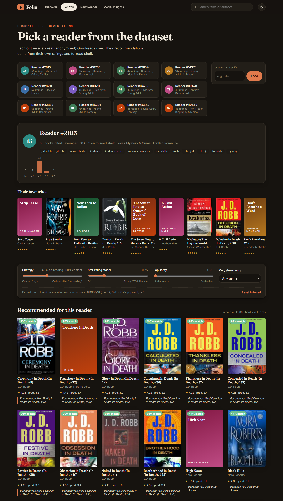
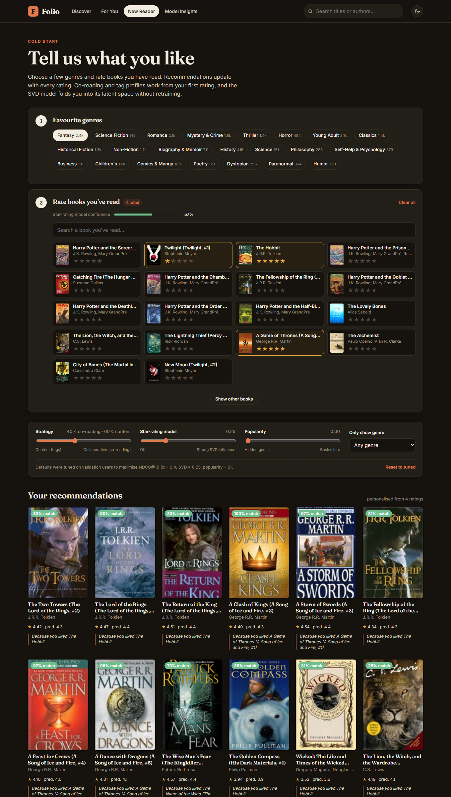
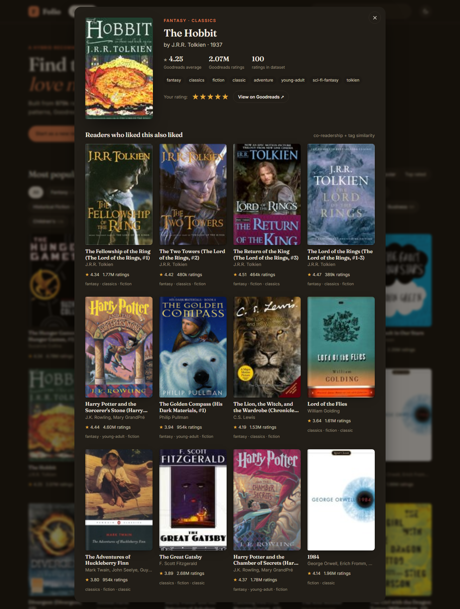
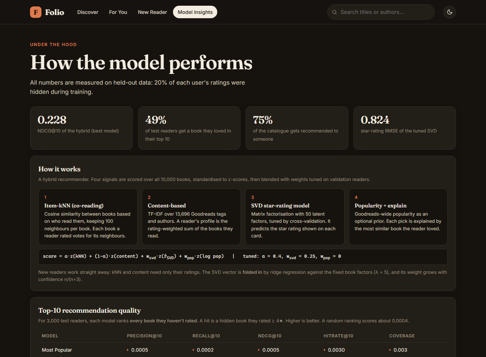

<div align="center">

# 📚 Folio: a Hybrid Book Recommender System

**Finds the book you'll love next.** It blends what similar readers read, Goodreads tags and an SVD rating model, and shows it all in a web app.


</div>

---

## Contents
- [What it does](#what-it-does)
- [Quick start](#quick-start)
- [Screenshots](#screenshots)
- [How it works](#how-it-works)
- [Results](#results)
- [Project structure](#project-structure)
- [API](#api)
- [Re-training the model](#re-training-the-model)
- [Notes on the dataset](#notes-on-the-dataset)

## What it does

Folio is a **recommender system**, not a classifier: for every reader it scores all 10,000 books and **ranks** the ones they haven't read yet. It is built on the [Goodbooks-10k](https://github.com/zygmuntz/goodbooks-10k) dataset (≈980k ratings, 53k readers, 10k books).

| Feature | |
|---|---|
| 🎯 **Personalised recommendations** | for any reader in the dataset, with a reason for each pick ("Because you liked *The Hobbit*") |
| 🌱 **Cold start** | a new reader picks genres and rates a few books; recommendations update live, without retraining |
| 🔗 **Similar books** | "Readers who liked this also liked…" for any title |
| 🎛️ **Live controls** | sliders that change the blend of signals in the hybrid, so you can see what each one contributes |
| 📊 **Model insights** | the full evaluation (tables, tuning heatmap, hyper-parameter search) inside the app |
| 📓 **Report notebook** | [`notebooks/book.ipynb`](notebooks/book.ipynb): EDA → models → evaluation → export, with outputs |

## Quick start

The trained model is included in `artifacts/`, so the app runs without training.

**Windows:** double-click **`run.bat`**.
**macOS / Linux:** `./run.sh`

Or by hand:

```bash
git clone https://github.com/mihirr-spec/RecommenderSystem.git
cd RecommenderSystem
python -m venv .venv
.venv\Scripts\activate          # macOS/Linux: source .venv/bin/activate
pip install -r requirements.txt
python app.py --open            # http://127.0.0.1:8000  (API docs at /docs)
```

## Screenshots

| For You: a real reader's profile and picks | New Reader: cold start |
|---|---|
|  |  |

| Book page: similar books | Model Insights |
|---|---|
|  |  |

## How it works

```
                     ┌──────────────── for each reader, score all 10,000 books ────────────────┐
ratings.csv ───────► │ Item-kNN (co-reading)        "readers of X also read Y", 100 neighbours │
to_read.csv ───────► │ SVD (Surprise, tuned)         predicted stars  r̂ = μ + b_u + b_i + p_u·q_i│──► z-score ──► weighted blend ──► top-N + reason
book_tags.csv ─────► │ Content (TF-IDF tags+author)  cosine to the reader's taste profile      │
books.csv ─────────► │ Popularity (Goodreads count)  optional prior                            │
                     └─────────────────────────────────────────────────────────────────────────┘

score = α·z(kNN) + (1−α)·z(content) + w_svd·z(SVD) + w_pop·z(log popularity)
```

* **Weights** are tuned on 1,500 validation readers and reported on 3,000 *different* test readers. The tuned values are α = 0.4, w_svd = 0.25 and w_pop = 0.
* **Cold start:** with no ratings, a reader gets the top-rated books (Bayesian average) in their genres. From the first rating, kNN and content work directly. Their SVD vector is **folded in** with ridge regression against the fixed book factors (λ = 5, tuned), and its weight grows as n/(n+3).
* **Explanations:** each pick names the liked book most similar to it (co-reading + tags), or the taste tags it shares with the reader.
* **Serving:** the trained models are exported to plain NumPy/SciPy arrays, so the web app doesn't need Surprise or scikit-learn. A full-catalogue recommendation takes about 10–100 ms.

## Results

Each reader's ratings are split 80/20. The 20% stays hidden during training, and each model must find those books among **all** the books the reader hasn't rated. A hit is a hidden book rated ≥ 4★.

**Top-10 ranking, 3,000 test readers (higher is better)**

| Model | Precision@10 | Recall@10 | NDCG@10 | HitRate@10 | Coverage |
|---|---|---|---|---|---|
| Most Popular | 0.0005 | 0.0002 | 0.0005 | 0.3% | 0.3% |
| SVD (explicit ratings) | 0.0005 | 0.0012 | 0.0008 | 0.4% | 1.1% |
| Content-based (tags + author) | 0.0624 | 0.1957 | 0.1609 | 39.3% | 74.2% |
| Item-kNN (implicit co-reading) | 0.0841 | 0.2619 | 0.2273 | 48.6% | 73.6% |
| **Hybrid (tuned)** | **0.0851** | **0.2625** | **0.2284** | **49.0%** | **75.4%** |

**Star-rating prediction (lower is better)**

| Model | RMSE | MAE |
|---|---|---|
| Random | 1.322 | 1.055 |
| Baseline (user + item bias) | 0.838 | 0.661 |
| SVD, untuned | 0.836 | 0.652 |
| **SVD, tuned** (50 factors, 40 epochs, lr 0.005, reg 0.08) | **0.824** | **0.641** |

**Takeaways**
* The **hybrid** is the best model on every ranking metric. Nearly half of the readers get a book they loved in their top 10, and 75% of the catalogue gets recommended to someone. Most of the lift comes from co-reading (item-kNN).
* **Tuned SVD** is the best *rating* predictor but ranks poorly on its own: predicting *how many stars* is a different task from predicting *which books* someone reads.

## Project structure

```
├── app.py                  FastAPI backend: REST API + serves the UI
├── recsys/                 the recommender package
│   ├── config.py           paths, genre definitions, shelf-tag filter
│   ├── data.py             loading, ID mapping, de-duplication, genres, per-user split
│   ├── features.py         TF-IDF tag + author content matrix
│   ├── scoring.py          item-kNN, SVD scoring + fold-in, content profiles, hybrid blend
│   ├── evaluation.py       full-catalogue top-K metrics, coverage
│   ├── pipeline.py         tuning, baselines, ranking evaluator, artifact export
│   ├── train.py            `python -m recsys.train`: the whole pipeline end to end
│   └── engine.py           live recommender used by the API
├── static/                 frontend: index.html, styles.css, app.js (no build step)
├── artifacts/              trained model files loaded by the app
├── data/                   Goodbooks-10k CSVs
├── notebooks/
│   ├── book.ipynb          project report (executed, with outputs)
│   └── book_original.ipynb first version, kept for comparison
├── tests/test_api.py       API smoke tests (pytest)
├── docs/screenshots/
├── requirements.txt        to run the app
├── requirements-dev.txt    to train, run the notebook and the tests
└── run.bat / run.sh        one-click start
```

## API

Interactive docs at **http://127.0.0.1:8000/docs**.

| Method | Endpoint | |
|---|---|---|
| GET | `/api/popular?genre=&sort=popular\|top_rated&n=&offset=` | popular / top-rated books |
| GET | `/api/search?q=` | search titles and authors |
| GET | `/api/books/{id}` | book details + similar books |
| GET | `/api/books/{id}/similar?n=&beta=` | item-to-item recommendations |
| GET | `/api/users/sample` | example readers |
| GET | `/api/users/{id}` | reader profile |
| GET | `/api/users/{id}/recommendations?n=&alpha=&svd_weight=&pop_weight=&genre=` | personalised recommendations |
| POST | `/api/recommend` | cold start: `{"ratings": {"7": 5, "39": 4}, "genres": ["Fantasy"]}` |
| GET | `/api/stats` | dataset statistics and all evaluation results |

## Re-training the model

```bash
pip install -r requirements-dev.txt
python -m recsys.train          # full run with hyper-parameter search (~5 min)
python -m recsys.train --fast   # reuse the tuned SVD params from artifacts/meta.json
pytest                          # API smoke tests
```

To re-run the report, open `notebooks/book.ipynb` with the `.venv` interpreter as the kernel.

> On Windows, `scikit-surprise` may need the [Microsoft C++ Build Tools](https://visualstudio.microsoft.com/visual-cpp-build-tools/) to install. It is only needed for training; the app itself does not use it.

## Notes on the dataset

* **IDs:** `ratings.csv` and `to_read.csv` use `books.csv` **`id`** (1–10000), while `books.csv` `book_id` and `book_tags.csv` use the *Goodreads* ID. Mixing them up silently produces wrong books. That was the main bug in the [first version](notebooks/book_original.ipynb) of this project, which is fixed here.
* **Sampling:** Goodbooks-10k was sampled to about **100 ratings per book**. Popularity therefore carries no signal for predicting what someone rated in this data, and "Most Popular" scores close to random. On a real platform popularity would be a strong baseline.
* **2,278 duplicate ratings** are averaged.

## Credits

* Dataset: [Goodbooks-10k](https://github.com/zygmuntz/goodbooks-10k) by Zygmunt Zając. See its repository for licence terms.
* Collaborative filtering: [Surprise](https://surpriselib.com/).
* Book covers are loaded from Goodreads at runtime.

Code released under the [MIT License](LICENSE).
