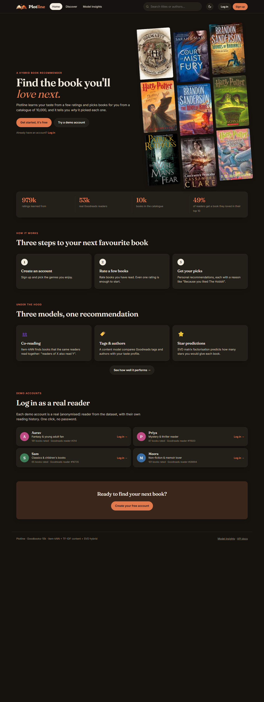
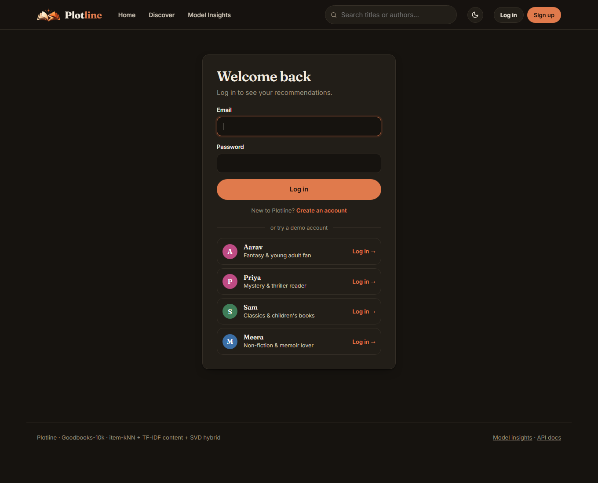
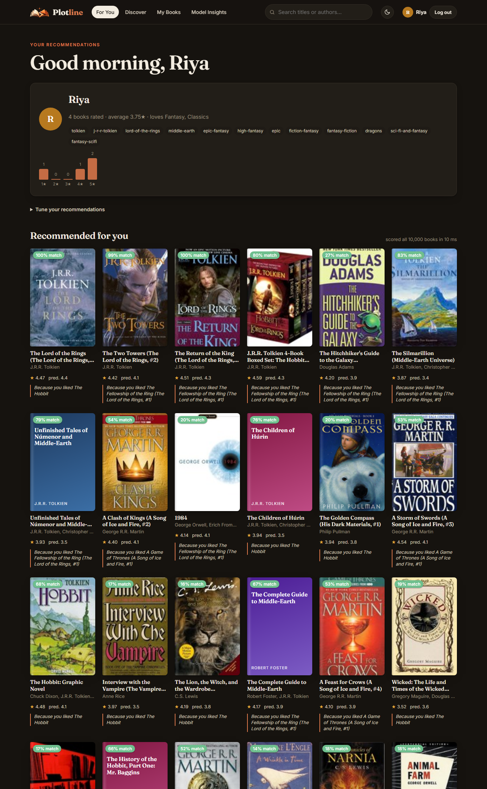
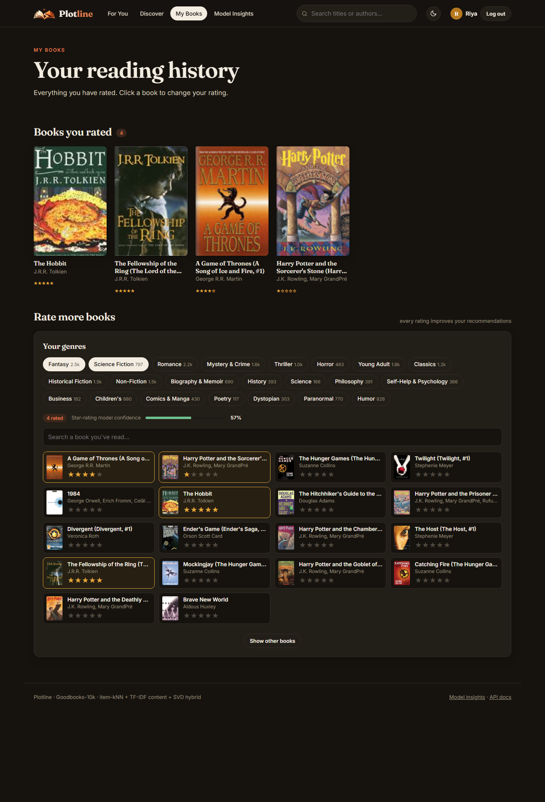

<p align="center"></p>

# Plotline: Book Recommender System

A book recommender system built on the [Goodbooks-10k](https://github.com/zygmuntz/goodbooks-10k) dataset (≈980k ratings, 53k users, 10k books), with a web app to try it out.



## Features
- **Accounts:** sign up, log in, and your ratings are saved
- **Onboarding:** a new user picks genres and rates a few books, and recommendations appear instantly
- **Demo accounts:** one-click log-in as one of 4 real readers from the dataset
- **Personalised recommendations**, each with a reason ("Because you liked *The Hobbit*")
- **My Books:** your rating history, and more books to rate
- **Discover** popular and top-rated books by genre, and **similar books** for any title
- **Model Insights** page showing how the model was evaluated

## How it works
The app combines three models into one hybrid score:
1. **Item-kNN:** "readers who read X also read Y"
2. **Content-based:** similarity of Goodreads tags and authors (TF-IDF)
3. **SVD:** matrix factorisation that predicts star ratings

The weights of the blend were tuned on a validation set. The hybrid finds a book the user loved in their top 10 for about 49% of test users.

## How to run
**Windows:** double-click `run.bat`. It opens http://127.0.0.1:8000.

Manually:
```bash
python -m venv .venv
.venv\Scripts\activate
pip install -r requirements.txt
python app.py --open
```
The trained model is already in `artifacts/`. To retrain it, run `python -m recsys.train`.

User accounts are stored in `plotline.db` (created automatically). Passwords are hashed and never stored in plain text.

## Project structure
```
├── app.py              backend (FastAPI)
├── accounts.py         user accounts: sign-up, log-in, saved ratings (SQLite)
├── recsys/             recommender code (data loading, models, training)
├── static/             frontend (HTML, CSS, JS)
├── artifacts/          trained model files
├── data/               dataset CSVs
├── notebooks/
│   ├── book.ipynb           full analysis and evaluation
│   └── book_original.ipynb  first version
├── docs/screenshots/
├── requirements.txt
└── run.bat
```

## Screenshots
| Log in | For You |
|---|---|
|  |  |

| My Books |
|---|
|  |
